# Project Evidence
## 1. Successful SSH Connection

This proves that the EC2 instance is reachable over SSH using the correct Ubuntu username and private key.
```
PS C:\Users\VICTUS> ssh -i "$HOME\.ssh\aws-lab-eu-west-2.pem" ubuntu@[PUBLIC-IP-REDACTED]
Welcome to Ubuntu 24.04.4 LTS (GNU/Linux 6.17.0-1017-aws x86_64)
ubuntu@ip-10-0-1-6:~$
```
## 2. SSH Authentication Failure with the Wrong Username

This proves that TCP connectivity reached the host and the SSH service responded, but authentication failed because the EC2 Name tag was used as the login username instead of the Ubuntu AMI's default user.
```
PS C:\Users\VICTUS> ssh -i "$HOME\.ssh\aws-lab-eu-west-2.pem" secure-aws-tf-web-01-dev@[PUBLIC-IP-REDACTED]
The authenticity of host '[PUBLIC-IP-REDACTED] ([PUBLIC-IP-REDACTED])' can't be established.
ED25519 key fingerprint is SHA256:s/2gnY7o/rFClEYC3e60DHkjH5drNhE0hTFCX6rK154.
This key is not known by any other names.
Are you sure you want to continue connecting (yes/no/[fingerprint])? yes
Warning: Permanently added '[PUBLIC-IP-REDACTED]' (ED25519) to the list of known hosts.
secure-aws-tf-web-01-dev@[PUBLIC-IP-REDACTED]: Permission denied (publickey).
```
## 3. Internet Connectivity from the Public EC2 Instance

This proves that the instance can reach Ubuntu package repositories through the public subnet's internet route.
```
ubuntu@ip-10-0-1-6:~$ sudo apt update
Hit:1 http://eu-west-2.ec2.archive.ubuntu.com/ubuntu noble InRelease
Get:2 http://eu-west-2.ec2.archive.ubuntu.com/ubuntu noble-updates InRelease [126 kB]
Get:3 http://eu-west-2.ec2.archive.ubuntu.com/ubuntu noble-backports InRelease [126 kB]
[... output trimmed ...]
Fetched 36.9 MB in 6s (6247 kB/s)
Reading package lists... Done
Building dependency tree... Done
Reading state information... Done
143 packages can be upgraded. Run 'apt list --upgradable' to see them.
```
## 4. Private Network Interface and Public-IP NAT Behaviour

This proves that the EC2 instance holds only its private 10.0.1.6/24 address on ens5; the public IPv4 address is not configured on the instance itself because the Internet Gateway performs one-to-one NAT between the public address and the instance's private address.
```
ubuntu@ip-10-0-1-6:~$ ip addr show
1: lo: <LOOPBACK,UP,LOWER_UP> mtu 65536 qdisc noqueue state UNKNOWN group default qlen 1000
    link/loopback 00:00:00:00:00:00 brd 00:00:00:00:00:00
    inet 127.0.0.1/8 scope host lo
       valid_lft forever preferred_lft forever
    inet6 ::1/128 scope host noprefixroute
       valid_lft forever preferred_lft forever

2: ens5: <BROADCAST,MULTICAST,UP,LOWER_UP> mtu 9001 qdisc mq state UP group default qlen 1000
    link/ether 06:f1:73:6d:d6:4d brd ff:ff:ff:ff:ff:ff
    altname enp0s5
    inet 10.0.1.6/24 metric 100 brd 10.0.1.255 scope global dynamic ens5
       valid_lft 2443sec preferred_lft 2443sec
    inet6 fe80::4f1:73ff:fe6d:d64d/64 scope link
       valid_lft forever preferred_lft forever
```

## 5. IMDSv2 Enforcement

### 5a — IMDSv1 Blocked

This proves that the EC2 instance metadata service is reachable, but a metadata request without an IMDSv2 token is actively rejected with `401 Unauthorized`.

```text
ubuntu@ip-10-0-1-6:~$ curl -v http://169.254.169.254/
*   Trying 169.254.169.254:80...
* Connected to 169.254.169.254 (169.254.169.254) port 80
> GET / HTTP/1.1
> Host: 169.254.169.254
> User-Agent: curl/8.5.0
> Accept: */*
>
< HTTP/1.1 401 Unauthorized
< Content-Length: 0
< Date: Thu, 17 Sep 2026 12:35:34 GMT
< Server: EC2ws
< Connection: close
< Content-Type: text/plain
<
* Closing connection
```

The successful connection to `169.254.169.254:80` shows that the metadata service is reachable, while the `401 Unauthorized` response with `Content-Length: 0` shows that the tokenless request was actively refused rather than failing because the service was unreachable.

### 5b — IMDSv2 Token Flow Succeeds

This proves that an IMDSv2 session token can be obtained and successfully used to access EC2 instance metadata.

```text
ubuntu@ip-10-0-1-6:~$ TOKEN=`curl -X PUT "http://169.254.169.254/latest/api/token" -H "X-aws-ec2-metadata-token-ttl-seconds: 21600"`
  % Total    % Received % Xferd  Average Speed   Time    Time     Time  Current
                                 Dload  Upload   Total   Spent    Left  Speed
100    56  100    56    0     0  37308      0 --:--:-- --:--:-- --:--:-- 56000
ubuntu@ip-10-0-1-6:~$ curl -H "X-aws-ec2-metadata-token: $TOKEN" http://169.254.169.254/latest/meta-data/
ami-id
ami-launch-index
ami-manifest-path
block-device-mapping/
events/
hostname
identity-credentials/
instance-action
instance-id
instance-life-cycle
instance-type
local-hostname
local-ipv4
mac
metrics/
network/
placement/
profile
public-hostname
public-ipv4
public-keys/
reservation-id
security-groups
services/
ubuntu@ip-10-0-1-6:~$ curl -H "X-aws-ec2-metadata-token: $TOKEN" http://169.254.169.254/latest/meta-data/instance-id
[INSTANCE-ID-REDACTED]@ip-10-0-1-6:~$
```

Together, `5a` and `5b` demonstrate that **IMDSv2 is enforced**: tokenless metadata access is rejected with `401 Unauthorized`, while the token-based IMDSv2 workflow succeeds.

# Project Evidence

This file records evidence collected while building, testing, and securing the `secure-aws-terraform-infrastructure` project.

Only controls and behaviours that have been directly tested are recorded as confirmed.

---

## 1. Successful SSH Connection

This proves that the EC2 instance is reachable over SSH using the correct Ubuntu username and private key.

```text
PS C:\Users\VICTUS> ssh -i "$HOME\.ssh\aws-lab-eu-west-2.pem" ubuntu@[PUBLIC-IP-REDACTED]
Welcome to Ubuntu 24.04.4 LTS (GNU/Linux 6.17.0-1017-aws x86_64)
ubuntu@ip-10-0-1-6:~$
```

---

## 2. SSH Authentication Failure with the Wrong Username

This proves that TCP connectivity reached the host and the SSH service responded, but authentication failed because the EC2 Name tag was used as the login username instead of the Ubuntu AMI's default user.

```text
PS C:\Users\VICTUS> ssh -i "$HOME\.ssh\aws-lab-eu-west-2.pem" secure-aws-tf-web-01-dev@[PUBLIC-IP-REDACTED]
The authenticity of host '[PUBLIC-IP-REDACTED] ([PUBLIC-IP-REDACTED])' can't be established.
ED25519 key fingerprint is SHA256:s/2gnY7o/rFClEYC3e60DHkjH5drNhE0hTFCX6rK154.
This key is not known by any other names.
Are you sure you want to continue connecting (yes/no/[fingerprint])? yes
Warning: Permanently added '[PUBLIC-IP-REDACTED]' (ED25519) to the list of known hosts.
secure-aws-tf-web-01-dev@[PUBLIC-IP-REDACTED]: Permission denied (publickey).
```

---

## 3. Internet Connectivity from the Public EC2 Instance

This proves that the EC2 instance can reach Ubuntu package repositories through the public subnet's internet route.

```text
ubuntu@ip-10-0-1-6:~$ sudo apt update
Hit:1 http://eu-west-2.ec2.archive.ubuntu.com/ubuntu noble InRelease
Get:2 http://eu-west-2.ec2.archive.ubuntu.com/ubuntu noble-updates InRelease [126 kB]
Get:3 http://eu-west-2.ec2.archive.ubuntu.com/ubuntu noble-backports InRelease [126 kB]
.
.
.
Fetched 36.9 MB in 6s (6247 kB/s)
Reading package lists... Done
Building dependency tree... Done
Reading state information... Done
143 packages can be upgraded. Run 'apt list --upgradable' to see them.
```

---

## 4. Private Network Interface and Public-IP NAT Behaviour

This proves that the EC2 instance holds its private `10.0.1.6/24` address on `ens5` and does not have the assigned public IPv4 address configured directly on its Linux network interface.

```text
ubuntu@ip-10-0-1-6:~$ ip addr show
1: lo: <LOOPBACK,UP,LOWER_UP> mtu 65536 qdisc noqueue state UNKNOWN group default qlen 1000
    link/loopback 00:00:00:00:00:00 brd 00:00:00:00:00:00
    inet 127.0.0.1/8 scope host lo
       valid_lft forever preferred_lft forever
    inet6 ::1/128 scope host noprefixroute
       valid_lft forever preferred_lft forever
2: ens5: <BROADCAST,MULTICAST,UP,LOWER_UP> mtu 9001 qdisc mq state UP group default qlen 1000
    link/ether 06:f1:73:6d:d6:4d brd ff:ff:ff:ff:ff:ff
    altname enp0s5
    inet 10.0.1.6/24 metric 100 brd 10.0.1.255 scope global dynamic ens5
       valid_lft 2443sec preferred_lft 2443sec
    inet6 fe80::4f1:73ff:fe6d:d64d/64 scope link
       valid_lft forever preferred_lft forever
```

The instance only sees its private IPv4 address. For IPv4 internet communication, the Internet Gateway performs the translation between the instance's private IPv4 address and its assigned public IPv4 address.

---

## 5. IMDSv2 Enforcement

### 5a — IMDSv1 Blocked

This proves that the EC2 Instance Metadata Service is reachable, but a metadata request without an IMDSv2 token is actively rejected with `401 Unauthorized`.

```text
ubuntu@ip-10-0-1-6:~$ curl -v http://169.254.169.254/
*   Trying 169.254.169.254:80...
* Connected to 169.254.169.254 (169.254.169.254) port 80
> GET / HTTP/1.1
> Host: 169.254.169.254
> User-Agent: curl/8.5.0
> Accept: */*
>
< HTTP/1.1 401 Unauthorized
< Content-Length: 0
< Date: Thu, 17 Sep 2026 12:35:34 GMT
< Server: EC2ws
< Connection: close
< Content-Type: text/plain
<
* Closing connection
```

The successful connection to `169.254.169.254:80` proves that the metadata service is reachable.

The `401 Unauthorized` response with `Content-Length: 0` shows that the tokenless request was actively refused rather than failing because the service was unreachable.

### 5b — IMDSv2 Token Flow Succeeds

This proves that an IMDSv2 session token can be obtained and successfully used to access EC2 instance metadata.

```text
ubuntu@ip-10-0-1-6:~$ TOKEN=`curl -X PUT "http://169.254.169.254/latest/api/token" -H "X-aws-ec2-metadata-token-ttl-seconds: 21600"`
  % Total    % Received % Xferd  Average Speed   Time    Time     Time  Current
                                 Dload  Upload   Total   Spent    Left  Speed
100    56  100    56    0     0  37308      0 --:--:-- --:--:-- --:--:-- 56000
ubuntu@ip-10-0-1-6:~$ curl -H "X-aws-ec2-metadata-token: $TOKEN" http://169.254.169.254/latest/meta-data/
ami-id
ami-launch-index
ami-manifest-path
block-device-mapping/
events/
hostname
identity-credentials/
instance-action
instance-id
instance-life-cycle
instance-type
local-hostname
local-ipv4
mac
metrics/
network/
placement/
profile
public-hostname
public-ipv4
public-keys/
reservation-id
security-groups
services/
systemubuntu@ip-10-0-1-6:~$ cat ami-id
cat: ami-id: No such file or directory
ubuntu@ip-10-0-1-6:~$ curl -H "X-aws-ec2-metadata-token: $TOKEN" http://169.254.169.254/latest/meta-data/instance-id
[INSTANCE-ID-REDACTED]@ip-10-0-1-6:~$
```

Together, `5a` and `5b` demonstrate that IMDSv2 is enforced: tokenless metadata access is rejected, while the token-based IMDSv2 workflow succeeds.

### Console Configuration Record

The EC2 metadata options were changed through **Modify instance metadata options** so that IMDSv2 is required.

- **IMDSv2:** `Required`
- **Metadata response hop limit:** `1`

---

## 6. S3 Bucket Security Controls

The S3 bucket `the-markizza` was created in `eu-west-2` with Block Public Access, versioning, and default server-side encryption enabled.

### 6a — Bucket Created

The bucket was created successfully in the London AWS Region.

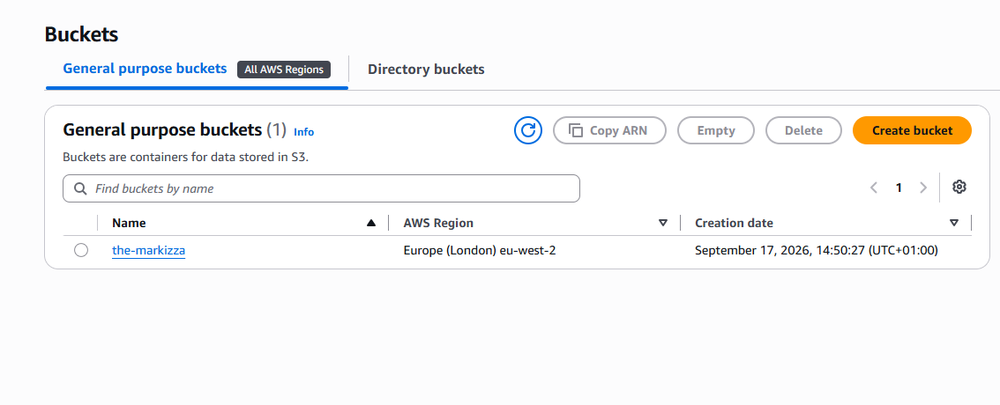

- **Bucket:** `the-markizza`
- **Region:** `Europe (London) eu-west-2`
- **Creation date:** `September 17, 2026, 14:50:27 (UTC+01:00)`

### 6b — Block Public Access Verified

Block Public Access was verified after bucket creation rather than relying only on the creation configuration.

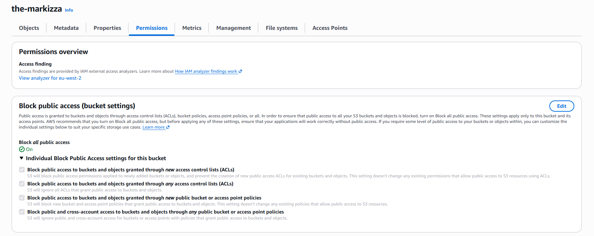

**Block all public access:** `On`

The four individual controls are enabled.

#### ACL Controls

- `BlockPublicAcls` — blocks new public ACLs from being added to buckets or objects.
- `IgnorePublicAcls` — prevents existing public ACL permissions from granting public access.

#### Bucket Policy Controls

- `BlockPublicPolicy` — prevents new bucket or access-point policies that grant public access.
- `RestrictPublicBuckets` — restricts public and cross-account access through public bucket or access-point policies.

All four controls were enabled at the time of testing.

### 6c — Versioning Verified

Bucket versioning is enabled.

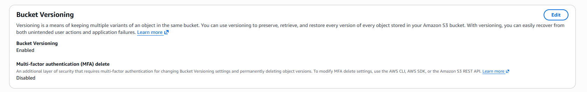

- **Bucket Versioning:** `Enabled`
- **MFA Delete:** `Disabled`

MFA Delete adds an additional protection layer around destructive versioning operations. When enabled, changing the bucket's versioning state or permanently deleting object versions requires authentication using the AWS account root user's MFA device.

**Status:** `Out of scope for the current project stage`

MFA Delete is not required to demonstrate basic S3 versioning and recoverability, so it has not been enabled during this stage of the project.

### 6d — Default Encryption Verified

The bucket uses server-side encryption with Amazon S3 managed keys.

**Encryption algorithm:** `SSE-S3`

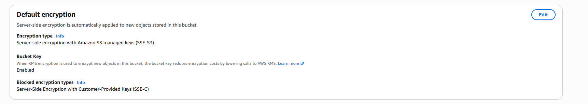

`SSE-S3` was chosen instead of `SSE-KMS` for this stage because the project requires encryption at rest without introducing additional KMS key-management complexity or KMS request costs.

Object-level verification confirms that encryption was applied to the uploaded object itself rather than only configured as a bucket default.

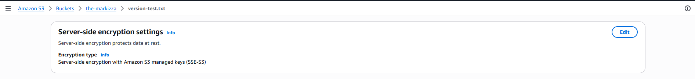

The object `version-test.txt` shows:

```text
Encryption type:
Server-side encryption with Amazon S3 managed keys (SSE-S3)
```

### 6e — Versioning Proven by Behaviour

The first version of `version-test.txt` was uploaded.

The local working file was then changed to contain the Version 2 content and uploaded again using the same object key:

`version-test.txt`

The original upload was made from:

`C:\Users\VICTUS\Desktop`

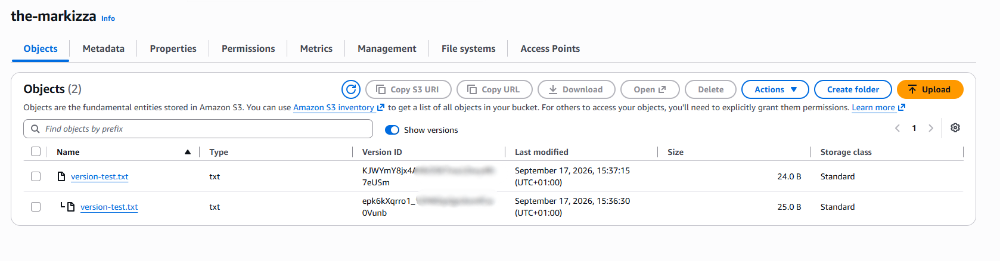

Two separate object versions were retained:

```text
Object key: version-test.txt

Current version:
Version ID: [REDACTED]
Last modified: September 17, 2026, 15:37:15 (UTC+01:00)
Size: 24.0 B

Previous version:
Version ID: [REDACTED]
Last modified: September 17, 2026, 15:36:30 (UTC+01:00)
Size: 25.0 B
```

The later version at `15:37:15` is the current version.

The earlier version at `15:36:30` remains stored under the same object key.

This proves that uploading modified content using an existing object key creates a new version rather than replacing the previous version.

#### Retrieval of the Non-Current Version

The older version of `version-test.txt` was selected from the S3 version history and downloaded successfully.

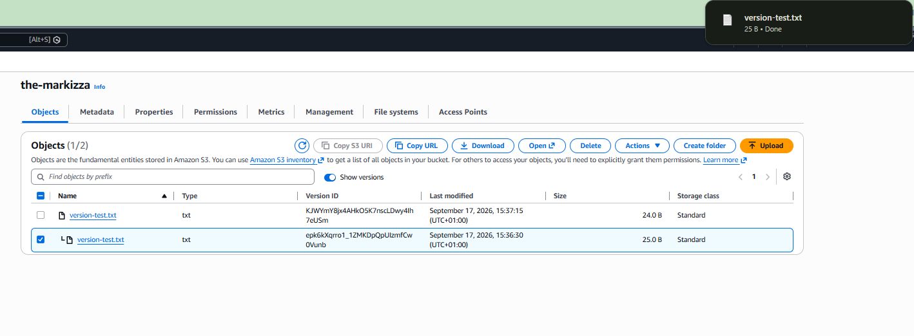

The selected non-current version was:

- **Object key:** `version-test.txt`
- **Last modified:** `September 17, 2026, 15:36:30 (UTC+01:00)`
- **Size:** `25.0 B`
- **Status:** `Non-current version`

The local working copy had already been changed to contain the Version 2 content before the second upload.

The version recovered from S3 was downloaded to:

```text
C:\Users\VICTUS\Downloads\version-test.txt
```

The recovered file was then read using PowerShell:

```powershell
PS C:\Users\VICTUS> get-content C:\Users\VICTUS\Downloads\version-test.txt
Version 1 - original file
PS C:\Users\VICTUS>
```

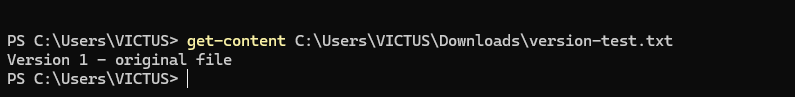

The recovered content is the original Version 1 content rather than the modified Version 2 content.

The downloaded object's `25.0 B` size also matches the non-current object version shown in S3.

This confirms that S3 Versioning preserved the previous object version and that the non-current version remained recoverable after the same object key was overwritten.

**Result:** `Confirmed`

Versioning demonstrated both:

- retention of multiple versions under the same object key
- successful recovery of a previous version

### 6f — Public Access Refused

#### 6f(i) — Anonymous GET with No Public Policy

An anonymous HTTP request was made directly to the object's S3 URL without AWS authentication credentials.

```text
ubuntu@ip-10-0-1-6:~$ curl -v https://the-markizza.s3.eu-west-2.amazonaws.com/version-test.txt
* Host the-markizza.s3.eu-west-2.amazonaws.com:443 was resolved.
* IPv6: (none)
* IPv4: 3.5.246.122, 52.95.142.6, 52.95.143.110, 3.5.245.40, 3.5.245.255, 52.95.149.146, 3.5.245.235, 52.95.150.114
*   Trying 3.5.246.122:443...
* Connected to the-markizza.s3.eu-west-2.amazonaws.com (3.5.246.122) port 443
* ALPN: curl offers h2,http/1.1
* TLSv1.3 (OUT), TLS handshake, Client hello (1):
*  CAfile: /etc/ssl/certs/ca-certificates.crt
*  CApath: /etc/ssl/certs
* TLSv1.3 (IN), TLS handshake, Server hello (2):
* TLSv1.3 (IN), TLS handshake, Encrypted Extensions (8):
* TLSv1.3 (IN), TLS handshake, Certificate (11):
* TLSv1.3 (IN), TLS handshake, CERT verify (15):
* TLSv1.3 (IN), TLS handshake, Finished (20):
* TLSv1.3 (OUT), TLS change cipher, Change cipher spec (1):
* TLSv1.3 (OUT), TLS handshake, Finished (20):
* SSL connection using TLSv1.3 / TLS_AES_128_GCM_SHA256 / X25519 / RSASSA-PSS
* ALPN: server accepted http/1.1
* Server certificate:
*  subject: CN=*.s3.eu-west-2.amazonaws.com
*  start date: Nov 17 00:00:00 2025 GMT
*  expire date: Nov  4 23:59:59 2026 GMT
*  subjectAltName: host "the-markizza.s3.eu-west-2.amazonaws.com" matched cert's "*.s3.eu-west-2.amazonaws.com"
*  issuer: C=US; O=Amazon; CN=Amazon RSA 2048 M04
*  SSL certificate verify ok.
*   Certificate level 0: Public key type RSA (2048/112 Bits/secBits), signed using sha256WithRSAEncryption
*   Certificate level 1: Public key type RSA (2048/112 Bits/secBits), signed using sha256WithRSAEncryption
*   Certificate level 2: Public key type RSA (2048/112 Bits/secBits), signed using sha256WithRSAEncryption
* using HTTP/1.x
> GET /version-test.txt HTTP/1.1
> Host: the-markizza.s3.eu-west-2.amazonaws.com
> User-Agent: curl/8.5.0
> Accept: */*
>
< HTTP/1.1 403 Forbidden
< x-amz-request-id: DJR89NBGQPWZEN5X
< x-amz-id-2: 6DTYQ1zd3sVH3eNyxiJ0TP+EQsgrnDFePuY2P3x+wgb8l72XkMFfiJ5AgOpbwCgUstDozalhoii1Tsi5wgKt72TxpvLJj+33
< Content-Type: application/xml
< Transfer-Encoding: chunked
< Date: Fri, 18 Sep 2026 12:59:17 GMT
< Server: AmazonS3
<
<?xml version="1.0" encoding="UTF-8"?>
* Connection #0 to host the-markizza.s3.eu-west-2.amazonaws.com left intact
<Error><Code>AccessDenied</Code><Message>Access Denied</Message><RequestId>DJR89NBGQPWZEN5X</RequestId><HostId>6DTYQ1zd3sVH3eNyxiJ0TP+EQsgrnDFePuY2P3x+wgb8l72XkMFfiJ5AgOpbwCgUstDozalhoii1Tsi5wgKt72TxpvLJj+33</HostId></Error>ubuntu@ip-10-0-1-6:~$
```

The request successfully reached Amazon S3 over HTTPS and S3 returned:

```text
HTTP/1.1 403 Forbidden
<Error>
    <Code>AccessDenied</Code>
    <Message>Access Denied</Message>
</Error>
```

This demonstrates that S3 received the anonymous request and made an authorisation decision.

A timeout, DNS failure, or TLS failure would not demonstrate that an access-control decision had been made.

This confirms **default-deny behaviour** for the anonymous request.

It does **not**, by itself, prove Block Public Access precedence because there was no public bucket policy granting anonymous access at this stage.

The same request would also be denied on a bucket without Block Public Access if no policy or ACL granted anonymous access.

The request is anonymous even though it was issued from an EC2 instance because the `curl` request contains no AWS Signature Version 4 authentication, presigned URL, or other AWS authorisation credentials.

#### 6f(ii) — Public Bucket Policy Rejected at Save Time

A bucket policy was prepared that attempted to grant anonymous users permission to retrieve objects:

```json
{
  "Version": "2012-10-17",
  "Statement": [
    {
      "Sid": "Statement1",
      "Principal": "*",
      "Effect": "Allow",
      "Action": "s3:GetObject",
      "Resource": "arn:aws:s3:::the-markizza/*"
    }
  ]
}
```

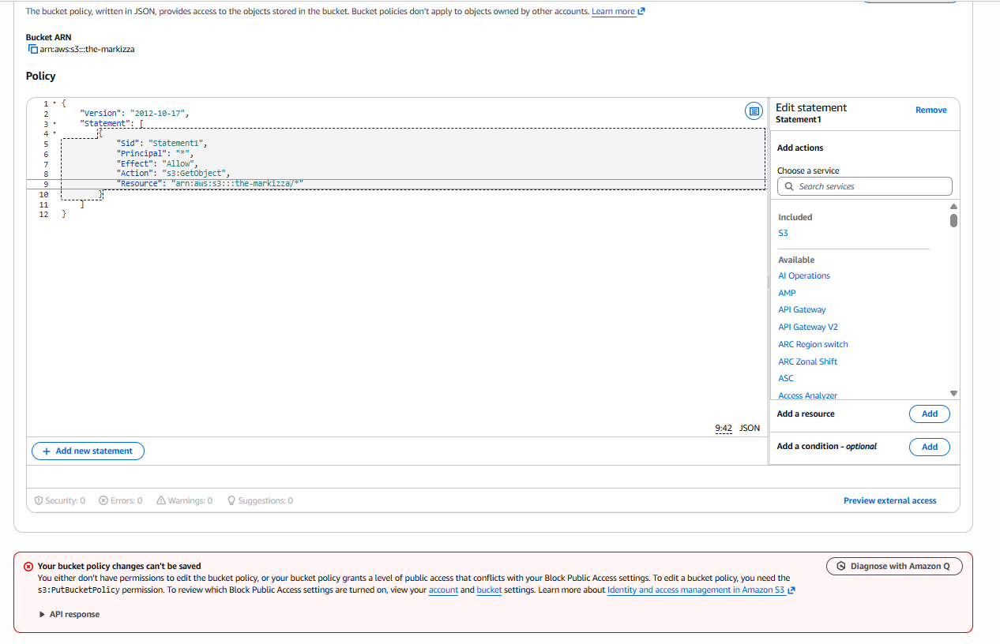

The AWS console displayed:

> **Your bucket policy changes can't be saved**
>
> You either don't have permissions to edit the bucket policy, or your bucket policy grants a level of public access that conflicts with your Block Public Access settings. To edit a bucket policy, you need the `s3:PutBucketPolicy` permission. To review which Block Public Access settings are turned on, view your account and bucket settings.

**Observed result:** the public policy was not saved.

The console error lists two possible causes:

- insufficient `s3:PutBucketPolicy` permission
- conflict with Block Public Access

This evidence therefore proves that the attempted public policy did not come into existence, but does not by itself attribute the rejection specifically to Block Public Access.

### 6g — Post-Test State

The environment was returned to a secure state after the completed tests.

- **Bucket Versioning:** `Enabled`
- **Default encryption:** `SSE-S3`
- **Block Public Access:** all four settings enabled
- **Anonymous GET:** `403 AccessDenied`
- **Public bucket policy:** not present
- **Object versions retained:** two versions of `version-test.txt`
- **Previous object version:** successfully recovered
- **MFA Delete:** `Disabled` and currently out of scope
- **EC2 instance:** `Stopped`

The attempted public bucket policy did not need to be removed because the save operation was rejected and the policy never came into existence.

## 7. Security Group Egress Restriction

The instance's outbound Security Group rule initially permitted all traffic to `0.0.0.0/0`, which is the AWS default.

This was replaced with a more restrictive outbound ruleset permitting only DNS, HTTP, and HTTPS traffic required by the current workload.

### 7a — Outbound Rules Before the Change

Before the restriction, the Security Group contained the default outbound rule permitting all IPv4 traffic to any destination:

```text
Type:        All traffic
Protocol:    All
Port range:  All
Destination: 0.0.0.0/0
```

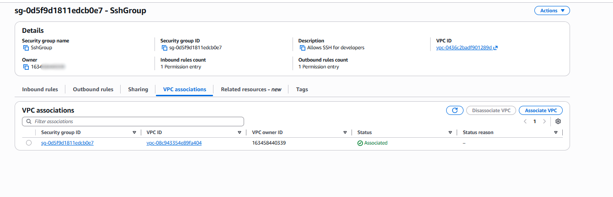

This configuration allowed the instance to initiate connections using any protocol and port to any IPv4 destination.

### 7b — Determining the DNS Resolver

The instance's resolver configuration was inspected before changing the outbound rules.

```text
ubuntu@ip-10-0-1-6:/$ cat /etc/resolv.conf
# This is /run/systemd/resolve/stub-resolv.conf managed by man:systemd-resolved(8).
# Do not edit.
#
# This file might be symlinked as /etc/resolv.conf. If you're looking at
# /etc/resolv.conf and seeing this text, you have followed the symlink.
#
# This is a dynamic resolv.conf file for connecting local clients to the
# internal DNS stub resolver of systemd-resolved. This file lists all
# configured search domains.
#
# Run "resolvectl status" to see details about the uplink DNS servers
# currently in use.
#
# Third party programs should typically not access this file directly, but only
# through the symlink at /etc/resolv.conf. To manage man:resolv.conf(5) in a
# different way, replace this symlink by a static file or a different symlink.
#
# See man:systemd-resolved.service(8) for details about the supported modes of
# operation for /etc/resolv.conf.

nameserver 127.0.0.53
options edns0 trust-ad
search eu-west-2.compute.internal
ubuntu@ip-10-0-1-6:/$ resolvectl status
Global
         Protocols: -LLMNR -mDNS -DNSOverTLS DNSSEC=no/unsupported
  resolv.conf mode: stub

Link 2 (ens5)
    Current Scopes: DNS
         Protocols: +DefaultRoute -LLMNR -mDNS -DNSOverTLS DNSSEC=no/unsupported
Current DNS Server: 10.0.0.2
       DNS Servers: 10.0.0.2
        DNS Domain: eu-west-2.compute.internal
```

`127.0.0.53` is the local `systemd-resolved` stub listener.

`resolvectl status` shows that the upstream resolver is:

```text
10.0.0.2
```

The VPC uses:

```text
10.0.0.0/16
```

and the Amazon-provided resolver is available at the VPC base address plus two:

```text
10.0.0.2
```

A `/32` represents one IPv4 address only:

```text
10.0.0.2/32 → only 10.0.0.2
```

By comparison:

```text
10.0.0.0/24 → 10.0.0.0 through 10.0.0.255
```

Therefore, `/32` is appropriate when referring specifically to the single resolver address.

An AWS-specific exception applies: Security Groups do not filter DNS traffic to or from the Amazon-provided Route 53 Resolver at `10.0.0.2`.

The DNS rules are nevertheless retained intentionally. They document the intended DNS destination, and no broader outbound rule permits TCP or UDP port `53` to arbitrary external resolvers.

### 7c — Outbound Ruleset Applied

The unrestricted `All traffic` outbound rule was removed and replaced with:

| Type | Protocol | Port | Destination | Purpose |
|---|---|---:|---|---|
| HTTP | TCP | `80` | `0.0.0.0/0` | Package repository and required HTTP connectivity |
| HTTPS | TCP | `443` | `0.0.0.0/0` | Package repository and required HTTPS connectivity |
| DNS | TCP | `53` | `10.0.0.2/32` | Intended DNS resolver; TCP fallback and larger responses |
| DNS | UDP | `53` | `10.0.0.2/32` | Intended DNS resolver for standard DNS queries |

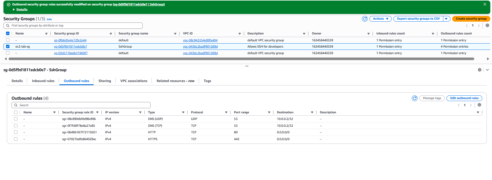

HTTP and HTTPS remain permitted to `0.0.0.0/0`.

Security Groups operate on IP address, protocol, and port rather than application hostnames. The practical reason these web rules remain broadly scoped is demonstrated by the connectivity test in the next section.

### 7d — Connectivity Confirmed After Restriction

After applying the restricted outbound rules, package repository connectivity was tested again using:

```bash
sudo apt update
```

```text
ubuntu@ip-10-0-1-6:/$ sudo apt update
Hit:1 http://eu-west-2.ec2.archive.ubuntu.com/ubuntu noble InRelease
Get:2 http://eu-west-2.ec2.archive.ubuntu.com/ubuntu noble-updates InRelease [126 kB]
Get:3 http://eu-west-2.ec2.archive.ubuntu.com/ubuntu noble-backports InRelease [126 kB]
Get:4 http://security.ubuntu.com/ubuntu noble-security InRelease [126 kB]
Get:5 http://eu-west-2.ec2.archive.ubuntu.com/ubuntu noble-updates/main amd64 Packages [1275 kB]
Get:6 http://eu-west-2.ec2.archive.ubuntu.com/ubuntu noble-updates/main amd64 Components [181 kB]
Get:7 http://eu-west-2.ec2.archive.ubuntu.com/ubuntu noble-updates/universe amd64 Packages [1689 kB]
Get:8 http://eu-west-2.ec2.archive.ubuntu.com/ubuntu noble-updates/universe amd64 Components [387 kB]
Get:9 http://eu-west-2.ec2.archive.ubuntu.com/ubuntu noble-updates/multiverse amd64 Components [940 B]
Get:10 http://eu-west-2.ec2.archive.ubuntu.com/ubuntu noble-backports/main amd64 Packages [40.6 kB]
Get:11 http://eu-west-2.ec2.archive.ubuntu.com/ubuntu noble-backports/main amd64 Components [5744 B]
Get:12 http://eu-west-2.ec2.archive.ubuntu.com/ubuntu noble-backports/universe amd64 Packages [31.0 kB]
Get:13 http://eu-west-2.ec2.archive.ubuntu.com/ubuntu noble-backports/universe Translation-en [18.6 kB]
Get:14 http://eu-west-2.ec2.archive.ubuntu.com/ubuntu noble-backports/universe amd64 Components [12.6 kB]
Get:15 http://security.ubuntu.com/ubuntu noble-security/main amd64 Components [46.4 kB]
Get:16 http://security.ubuntu.com/ubuntu noble-security/universe amd64 Packages [1208 kB]
Get:17 http://security.ubuntu.com/ubuntu noble-security/universe amd64 Components [76.3 kB]
Fetched 5351 kB in 1s (4114 kB/s)
Reading package lists... Done
Building dependency tree... Done
Reading state information... Done
35 packages can be upgraded. Run 'apt list --upgradable' to see them.
```

The output contained successful `Hit:` and/or `Get:` responses from multiple Ubuntu package sources, including:

```text
eu-west-2.ec2.archive.ubuntu.com
security.ubuntu.com
```

This demonstrates that the instance retained required package-management connectivity after the unrestricted all-traffic rule was removed.

It also shows why restricting HTTP egress to a single fixed destination would be unreliable: normal package updates reached at least two different hostnames, and their backing IP addresses may change.

For this stage, the required web egress therefore remains:

```text
TCP 80  → 0.0.0.0/0
TCP 443 → 0.0.0.0/0
```

**Result:** required package-management connectivity remained available after the egress restriction.

### 7e — Existing SSH Session Unaffected

The SSH session established before the Security Group change remained usable throughout the test.

Security Groups are stateful.

Return traffic associated with an allowed inbound SSH connection is automatically permitted and does not require a separate outbound TCP `22` rule.

The egress restriction therefore did not terminate the existing SSH session.

### 7f — Residual Egress Exposure

The original unrestricted rule:

```text
All traffic
All protocols
All ports
0.0.0.0/0
```

has been removed.

The remaining general internet-facing egress is:

```text
TCP 80  → 0.0.0.0/0
TCP 443 → 0.0.0.0/0
```

This is substantially narrower than permitting every protocol and port, but HTTP and HTTPS can still reach arbitrary internet destinations.

DNS remains documented as:

```text
UDP 53 → 10.0.0.2/32
TCP 53 → 10.0.0.2/32
```

although Security Groups do not evaluate traffic to the Amazon-provided resolver itself.

This does not prevent DNS-over-HTTPS traffic from using the currently permitted TCP `443` path.

Further restriction would require additional controls such as:

- an egress proxy
- AWS Network Firewall
- managed or custom prefix lists where suitable
- application-aware filtering
- Route 53 Resolver DNS Firewall for DNS-specific policy enforcement

**Result:** unrestricted all-protocol egress was removed successfully while required package-management, DNS-resolution, and SSH functionality remained available.

## 8. CloudTrail Management Event Logging

AWS CloudTrail was enabled to create a persistent audit trail of management activity in the AWS account.

The test focused on whether a deliberate Security Group configuration change could later be reconstructed from the CloudTrail records delivered to Amazon S3.

### 8a — Trail Configuration

The CloudTrail trail was configured as follows:

- **Trail name:** `management-events`
- **Trail logging:** `Logging`
- **Scope:** Multi-Region
- **Organization trail:** Not enabled
- **Log destination:** Amazon S3
- **Log file validation:** Enabled
- **SSE-KMS encryption:** Not enabled
- **SNS notification delivery:** Disabled
- **Recursive logging:** Enabled

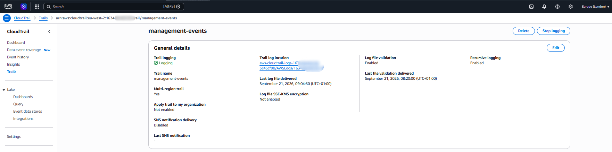

A Multi-Region trail was selected so that management activity is not limited to events generated only in `eu-west-2`.

Log file validation was enabled to provide integrity evidence for delivered CloudTrail log files.

The destination bucket, account ID, and trail ARN are redacted in the public evidence because they are not required to demonstrate the control.

---

### 8b — CloudTrail Destination Bucket Policy

Creating the trail added permissions to the destination S3 bucket so that the CloudTrail service can verify the bucket and deliver log objects.

The actual bucket policy configured on the destination bucket was:

```json
{
    "Version": "2012-10-17",
    "Statement": [
        {
            "Sid": "AWSCloudTrailAclCheck20150319-e529c59d-4569-4d57-8aa3-a9ecf52c7af3",
            "Effect": "Allow",
            "Principal": {
                "Service": "cloudtrail.amazonaws.com"
            },
            "Action": "s3:GetBucketAcl",
            "Resource": "arn:aws:s3:::[CLOUDTRAIL-BUCKET-REDACTED]",
            "Condition": {
                "StringEquals": {
                    "AWS:SourceArn": "arn:aws:cloudtrail:eu-west-2:[ACCOUNT-ID-REDACTED]:trail/management-events"
                }
            }
        },
        {
            "Sid": "AWSCloudTrailWrite20150319-abb11b64-b9f7-4b90-b48a-340800a0a87f",
            "Effect": "Allow",
            "Principal": {
                "Service": "cloudtrail.amazonaws.com"
            },
            "Action": "s3:PutObject",
            "Resource": "arn:aws:s3:::[CLOUDTRAIL-BUCKET-REDACTED]/AWSLogs/[ACCOUNT-ID-REDACTED]/*",
            "Condition": {
                "StringEquals": {
                    "AWS:SourceArn": "arn:aws:cloudtrail:eu-west-2:[ACCOUNT-ID-REDACTED]:trail/management-events",
                    "s3:x-amz-acl": "bucket-owner-full-control"
                }
            }
        }
    ]
}
```

The policy contains two CloudTrail service permissions.

`cloudtrail.amazonaws.com` is granted:

```text
s3:GetBucketAcl
```

so CloudTrail can check the destination bucket.

It is also granted:

```text
s3:PutObject
```

for the account-specific CloudTrail log prefix:

```text
AWSLogs/[ACCOUNT-ID-REDACTED]/*
```

The `AWS:SourceArn` condition restricts these permissions to the specific trail:

```text
management-events
```

rather than granting the permissions generally to any CloudTrail trail.

The write statement also requires:

```text
s3:x-amz-acl = bucket-owner-full-control
```

for objects delivered by CloudTrail.

---

### 8c — Log Delivery Path

The CloudTrail management events were located in the following delivered S3 object:

```text
s3://[CLOUDTRAIL-BUCKET-REDACTED]/AWSLogs/[ACCOUNT-ID-REDACTED]/CloudTrail/eu-west-2/2026/09/21/[ACCOUNT-ID-REDACTED]_CloudTrail_eu-west-2_20260921T0755Z_mCmJoucdI7CsDDn6.json.gz
```

The object path shows CloudTrail's account-, Region-, and date-based organisation:

```text
AWSLogs/
└── [ACCOUNT-ID-REDACTED]/
    └── CloudTrail/
        └── eu-west-2/
            └── 2026/
                └── 09/
                    └── 21/
                        └── [LOG-FILE].json.gz
```

The relevant filename is:

```text
[ACCOUNT-ID-REDACTED]_CloudTrail_eu-west-2_20260921T0755Z_mCmJoucdI7CsDDn6.json.gz
```

The path identifies:

- the AWS account
- CloudTrail as the log type
- Region `eu-west-2`
- year `2026`
- month `09`
- day `21`

The filename contains the timestamp component:

```text
20260921T0755Z
```

---

### 8d — Test Action Performed

To generate a known management event after the trail was enabled, a temporary outbound Security Group rule was deliberately added and then removed.

The temporary rule was:

```text
Type:        POP3
Protocol:    TCP
Port:        110
Destination: 0.0.0.0/0
```

POP3 was chosen because the current EC2 workload does not require TCP port `110`, so the temporary rule could be created and removed without affecting the workload.

CloudTrail recorded the rule being added at:

```text
2026-09-21T07:52:36Z
```

and removed at:

```text
2026-09-21T07:52:48Z
```

The timestamps are recorded in UTC.

The temporary rule therefore existed for approximately:

```text
12 seconds
```

before being revoked.

---

### 8e — Events Located in the Delivered Log

The delivered CloudTrail log contained both sides of the Security Group configuration change:

```text
AuthorizeSecurityGroupEgress
RevokeSecurityGroupEgress
```

Both events were located in:

```text
s3://[CLOUDTRAIL-BUCKET-REDACTED]/AWSLogs/[ACCOUNT-ID-REDACTED]/CloudTrail/eu-west-2/2026/09/21/[ACCOUNT-ID-REDACTED]_CloudTrail_eu-west-2_20260921T0755Z_mCmJoucdI7CsDDn6.json.gz
```

#### Authorize Event

```json
{
    "eventVersion": "1.11",
    "userIdentity": {
        "type": "IAMUser",
        "principalId": "[REDACTED]",
        "arn": "[REDACTED]",
        "accountId": "[REDACTED]",
        "accessKeyId": "[REDACTED]",
        "userName": "[IAM-USER-REDACTED]",
        "sessionContext": {
            "attributes": {
                "creationDate": "2026-09-21T05:11:44Z",
                "mfaAuthenticated": "true"
            }
        }
    },
    "eventTime": "2026-09-21T07:52:36Z",
    "eventSource": "ec2.amazonaws.com",
    "eventName": "AuthorizeSecurityGroupEgress",
    "awsRegion": "eu-west-2",
    "sourceIPAddress": "[REDACTED]",
    "userAgent": "Mozilla/5.0 (Windows NT 10.0; Win64; x64) AppleWebKit/537.36 (KHTML, like Gecko) Chrome/153.0.0.0 Safari/537.36",
    "requestParameters": {
        "groupId": "[REDACTED]",
        "ipPermissions": {
            "items": [
                {
                    "ipProtocol": "tcp",
                    "fromPort": 110,
                    "toPort": 110,
                    "groups": {},
                    "ipRanges": {
                        "items": [
                            {
                                "cidrIp": "0.0.0.0/0"
                            }
                        ]
                    },
                    "ipv6Ranges": {},
                    "prefixListIds": {}
                }
            ]
        }
    },
    "responseElements": {
        "requestId": "6a7ba493-6b94-46a7-9207-6c4aed49e5aa",
        "_return": true,
        "securityGroupRuleSet": {
            "items": [
                {
                    "groupOwnerId": "[REDACTED]",
                    "groupId": "[REDACTED]",
                    "securityGroupRuleId": "[REDACTED]",
                    "isEgress": true,
                    "ipProtocol": "tcp",
                    "fromPort": 110,
                    "toPort": 110,
                    "cidrIpv4": "0.0.0.0/0",
                    "securityGroupRuleArn": "[REDACTED]"
                }
            ]
        }
    },
    "requestID": "6a7ba493-6b94-46a7-9207-6c4aed49e5aa",
    "eventID": "8b128ffa-e07e-485d-8bbe-3cb593b2c19d",
    "readOnly": false,
    "eventType": "AwsApiCall",
    "managementEvent": true,
    "recipientAccountId": "[REDACTED]",
    "eventCategory": "Management",
    "tlsDetails": {
        "tlsVersion": "TLSv1.3",
        "cipherSuite": "TLS_AES_128_GCM_SHA256",
        "clientProvidedHostHeader": "ec2.eu-west-2.amazonaws.com"
    },
    "sessionCredentialFromConsole": "true"
}
```

The event records the creation of the temporary egress rule.

The relevant fields show:

```text
eventName:      AuthorizeSecurityGroupEgress
eventSource:    ec2.amazonaws.com
awsRegion:      eu-west-2
managementEvent: true
readOnly:       false
```

The exact rule appears in `requestParameters`:

```text
Protocol:    TCP
From port:   110
To port:     110
Destination: 0.0.0.0/0
```

The API operation succeeded:

```text
"_return": true
```

The identity information also shows:

```text
type:             IAMUser
mfaAuthenticated: true
```

and:

```text
sessionCredentialFromConsole: true
```

showing that the API call originated from an authenticated AWS Management Console session.

#### Revoke Event

```json
{
    "eventVersion": "1.11",
    "userIdentity": {
        "type": "IAMUser",
        "principalId": "[REDACTED]",
        "arn": "[REDACTED]",
        "accountId": "[REDACTED]",
        "accessKeyId": "[REDACTED]",
        "userName": "[IAM-USER-REDACTED]",
        "sessionContext": {
            "attributes": {
                "creationDate": "2026-09-21T05:11:44Z",
                "mfaAuthenticated": "true"
            }
        }
    },
    "eventTime": "2026-09-21T07:52:48Z",
    "eventSource": "ec2.amazonaws.com",
    "eventName": "RevokeSecurityGroupEgress",
    "awsRegion": "eu-west-2",
    "sourceIPAddress": "[REDACTED]",
    "userAgent": "Mozilla/5.0 (Windows NT 10.0; Win64; x64) AppleWebKit/537.36 (KHTML, like Gecko) Chrome/153.0.0.0 Safari/537.36",
    "requestParameters": {
        "groupId": "[REDACTED]",
        "ipPermissions": {
            "items": [
                {
                    "ipProtocol": "tcp",
                    "fromPort": 110,
                    "toPort": 110,
                    "groups": {},
                    "ipRanges": {
                        "items": [
                            {
                                "cidrIp": "0.0.0.0/0"
                            }
                        ]
                    },
                    "ipv6Ranges": {},
                    "prefixListIds": {}
                }
            ]
        }
    },
    "responseElements": {
        "requestId": "58daaf83-9aba-454e-a876-07225e8cbdc5",
        "_return": true,
        "revokedSecurityGroupRuleSet": {
            "items": [
                {
                    "groupId": "[REDACTED]",
                    "securityGroupRuleId": "[REDACTED]",
                    "isEgress": true,
                    "ipProtocol": "tcp",
                    "fromPort": 110,
                    "toPort": 110,
                    "cidrIpv4": "0.0.0.0/0"
                }
            ]
        }
    },
    "requestID": "58daaf83-9aba-454e-a876-07225e8cbdc5",
    "eventID": "a2c98759-8049-40ee-a240-949821bdba8d",
    "readOnly": false,
    "eventType": "AwsApiCall",
    "managementEvent": true,
    "recipientAccountId": "[REDACTED]",
    "eventCategory": "Management",
    "tlsDetails": {
        "tlsVersion": "TLSv1.3",
        "cipherSuite": "TLS_AES_128_GCM_SHA256",
        "clientProvidedHostHeader": "ec2.eu-west-2.amazonaws.com"
    },
    "sessionCredentialFromConsole": "true"
}
```

The second event records removal of the same Security Group rule:

```text
eventName: RevokeSecurityGroupEgress

Protocol:    TCP
From port:   110
To port:     110
Destination: 0.0.0.0/0
```

The response again records:

```text
"_return": true
```

confirming that the revoke operation succeeded.

#### Forensic Reconstruction

The key CloudTrail fields answer the main questions an investigator would ask:

| Question | CloudTrail field | Evidence |
|---|---|---|
| Who performed the action? | `userIdentity` | IAM user |
| Was MFA used? | `sessionContext.attributes.mfaAuthenticated` | `true` |
| What happened? | `eventName` | `AuthorizeSecurityGroupEgress` / `RevokeSecurityGroupEgress` |
| Which AWS service handled it? | `eventSource` | `ec2.amazonaws.com` |
| When did it happen? | `eventTime` | `07:52:36Z` / `07:52:48Z` |
| In which Region? | `awsRegion` | `eu-west-2` |
| Where did the request originate? | `sourceIPAddress`, `userAgent` | source redacted; browser details retained |
| What configuration changed? | `requestParameters` | TCP `110` to `0.0.0.0/0` |
| Was it a management event? | `managementEvent` | `true` |
| Did the API operation succeed? | `responseElements._return` | `true` |

`requestParameters` is particularly useful because it records the exact configuration that was changed rather than merely stating that the Security Group was modified.

Together, the two events reconstruct the complete sequence:

```text
2026-09-21T07:52:36Z
AuthorizeSecurityGroupEgress
        ↓
TCP 110 → 0.0.0.0/0 added
        ↓
12 seconds
        ↓
2026-09-21T07:52:48Z
RevokeSecurityGroupEgress
        ↓
TCP 110 → 0.0.0.0/0 removed
```

The containing CloudTrail log file has the filename timestamp:

```text
20260921T0755Z
```

while the two API events occurred at:

```text
07:52:36Z
07:52:48Z
```

This shows that the events were delivered into a CloudTrail log object within a few minutes of the API activity.

An exact delivery delay is not claimed because the timestamp embedded in the log filename does not establish the precise S3 object-arrival time.

---

### 8f — Trail Delivery Is Not Retroactive

The Security Group egress-hardening work documented in Section 7 was performed before this CloudTrail trail was created.

Those earlier actions are therefore not presented as events delivered by this trail to S3.

The temporary POP3 rule was deliberately created after the trail was active so that a known management event could be generated and then located in the delivered log files.

CloudTrail Event History and an S3-delivering trail serve different purposes.

```text
CloudTrail Event History
        ↓
Recent management-event lookup

CloudTrail Trail
        ↓
Ongoing log delivery
        ↓
Amazon S3
        ↓
Longer-term retention
```

Creating the trail does not cause earlier Event History records to be retroactively written into the trail's historical S3 log path.

The POP3 test therefore establishes evidence generated after persistent trail delivery was configured.

---

### 8g — Audit Integrity Limitation

The trail currently delivers its logs to an S3 bucket within the same AWS account being audited.

This creates a trust-boundary limitation.

A sufficiently privileged principal that compromises the account and gains control over both CloudTrail and the destination S3 bucket could attempt to interfere with the account's own audit evidence.

The current trail has:

```text
Log file validation: Enabled
```

This provides an integrity mechanism for validating delivered CloudTrail log files.

However, integrity validation is different from preventing deletion or modification.

The current design can therefore be represented as:

```text
Workload Account
      │
      ├── EC2 / S3 / Security Groups
      │
      ├── CloudTrail
      │
      └── CloudTrail Log Bucket
```

The workload and its audit records remain within the same administrative trust boundary.

A stronger production architecture would separate those responsibilities:

```text
AWS Organization
        ↓
Organization Trail
        ↓
Dedicated Logging Account
        ↓
Protected S3 Log Bucket
        ↓
S3 Object Lock / retention controls
        ↓
Logging-account-controlled KMS key
```

In that design, workload accounts would not control the final audit-log storage location.

**Current mitigation:** CloudTrail log file validation is enabled.

**Current limitation:** the trail and destination bucket remain within the same AWS account.

**Status:** `Accepted limitation for this single-account lab`.

## 9. Terraform Infrastructure Rebuild and Reproducibility

The manually tested AWS architecture was recreated using Terraform and then tested through a complete destroy-and-rebuild cycle.

The purpose of this test was to prove that the environment could be reproduced from configuration rather than depending on manually created AWS resources.

### 9a — Destroy Plan

Before removing the infrastructure, I inspected the proposed destruction using:

```powershell
terraform plan -destroy
```

Verbatim output with sensitive identifiers redacted:

```text
PS C:\Users\VICTUS\projects\secure-aws-terraform-infrastructure\terraform> terraform plan -destroy
data.aws_ami.ubuntu: Reading...
aws_vpc.main: Refreshing state... [id=[VPC-ID-REDACTED]]
data.aws_ami.ubuntu: Read complete after 0s [id=[AMI-ID-REDACTED]]
aws_internet_gateway.main: Refreshing state... [id=[IGW-ID-REDACTED]]
aws_route_table.private: Refreshing state... [id=[PRIVATE-RT-ID-REDACTED]]
aws_route_table.public: Refreshing state... [id=[PUBLIC-RT-ID-REDACTED]]
aws_subnet.private: Refreshing state... [id=[PRIVATE-SUBNET-ID-REDACTED]]
aws_subnet.public: Refreshing state... [id=[PUBLIC-SUBNET-ID-REDACTED]]
aws_security_group.ec2: Refreshing state... [id=[SG-ID-REDACTED]]
aws_vpc_security_group_ingress_rule.ssh: Refreshing state... [id=[SG-RULE-ID-REDACTED]]
aws_vpc_security_group_egress_rule.dns_udp: Refreshing state... [id=[SG-RULE-ID-REDACTED]]
aws_vpc_security_group_egress_rule.dns_tcp: Refreshing state... [id=[SG-RULE-ID-REDACTED]]
aws_vpc_security_group_egress_rule.https: Refreshing state... [id=[SG-RULE-ID-REDACTED]]
aws_vpc_security_group_egress_rule.http: Refreshing state... [id=[SG-RULE-ID-REDACTED]]
aws_route_table_association.private: Refreshing state... [id=[RT-ASSOCIATION-ID-REDACTED]]
aws_instance.public: Refreshing state... [id=[INSTANCE-ID-REDACTED]]
aws_route_table_association.public: Refreshing state... [id=[RT-ASSOCIATION-ID-REDACTED]]
aws_route.public_internet: Refreshing state... [id=[ROUTE-ID-REDACTED]]

Terraform used the selected providers to generate the following execution plan. Resource actions are indicated with the
following symbols:
  - destroy

Terraform will perform the following actions:

  # aws_instance.public will be destroyed
  - resource "aws_instance" "public" {
      - ami                                  = "[AMI-ID-REDACTED]" -> null
      - arn                                  = "arn:aws:ec2:eu-west-2:[ACCOUNT-ID-REDACTED]:instance/[INSTANCE-ID-REDACTED]" -> null
      - associate_public_ip_address          = true -> null
      - availability_zone                    = "eu-west-2c" -> null

... middle of Terraform resource detail omitted ...

Plan: 0 to add, 0 to change, 16 to destroy.

Changes to Outputs:
  - ec2_instance_id   = "[INSTANCE-ID-REDACTED]" -> null
  - ec2_private_ip    = "10.0.1.107" -> null
  - ec2_public_ip     = "[PUBLIC-IP-REDACTED]" -> null
  - private_subnet_id = "[PRIVATE-SUBNET-ID-REDACTED]" -> null
  - public_subnet_id  = "[PUBLIC-SUBNET-ID-REDACTED]" -> null
  - vpc_id            = "[VPC-ID-REDACTED]" -> null

───────────────────────────────────────────────────────────────────────────────────────────────────────────────────────

Note: You didn't use the -out option to save this plan, so Terraform can't guarantee to take exactly these actions if
you run "terraform apply" now.
```

The destroy plan therefore showed:

```text
Plan: 0 to add, 0 to change, 16 to destroy.
```

No resources were proposed for creation or modification.

---

### 9b — Complete Infrastructure Destruction

The destruction was then performed using:

```powershell
terraform destroy
```

Verbatim output with sensitive identifiers redacted:

```text
PS C:\Users\VICTUS\projects\secure-aws-terraform-infrastructure\terraform> terraform destroy
data.aws_ami.ubuntu: Reading...
aws_vpc.main: Refreshing state... [id=[VPC-ID-REDACTED]]
data.aws_ami.ubuntu: Read complete after 0s [id=[AMI-ID-REDACTED]]
aws_internet_gateway.main: Refreshing state... [id=[IGW-ID-REDACTED]]
aws_route_table.private: Refreshing state... [id=[PRIVATE-RT-ID-REDACTED]]
aws_route_table.public: Refreshing state... [id=[PUBLIC-RT-ID-REDACTED]]
aws_subnet.private: Refreshing state... [id=[PRIVATE-SUBNET-ID-REDACTED]]
aws_subnet.public: Refreshing state... [id=[PUBLIC-SUBNET-ID-REDACTED]]
aws_security_group.ec2: Refreshing state... [id=[SG-ID-REDACTED]]
aws_route_table_association.private: Refreshing state... [id=[RT-ASSOCIATION-ID-REDACTED]]
aws_route.public_internet: Refreshing state... [id=[ROUTE-ID-REDACTED]]
aws_vpc_security_group_egress_rule.dns_tcp: Refreshing state... [id=[SG-RULE-ID-REDACTED]]
aws_vpc_security_group_egress_rule.https: Refreshing state... [id=[SG-RULE-ID-REDACTED]]
aws_vpc_security_group_ingress_rule.ssh: Refreshing state... [id=[SG-RULE-ID-REDACTED]]
aws_vpc_security_group_egress_rule.http: Refreshing state... [id=[SG-RULE-ID-REDACTED]]
aws_vpc_security_group_egress_rule.dns_udp: Refreshing state... [id=[SG-RULE-ID-REDACTED]]
aws_instance.public: Refreshing state... [id=[INSTANCE-ID-REDACTED]]
aws_route_table_association.public: Refreshing state... [id=[RT-ASSOCIATION-ID-REDACTED]]

... Terraform destroy plan detail omitted ...

Do you really want to destroy all resources?
  Terraform will destroy all your managed infrastructure, as shown above.
  There is no undo. Only 'yes' will be accepted to confirm.

  Enter a value: yes

aws_route_table_association.public: Destroying... [id=[RT-ASSOCIATION-ID-REDACTED]]
aws_route.public_internet: Destroying... [id=[ROUTE-ID-REDACTED]]
aws_instance.public: Destroying... [id=[INSTANCE-ID-REDACTED]]
aws_vpc_security_group_egress_rule.dns_udp: Destroying... [id=[SG-RULE-ID-REDACTED]]
aws_vpc_security_group_egress_rule.http: Destroying... [id=[SG-RULE-ID-REDACTED]]
aws_vpc_security_group_ingress_rule.ssh: Destroying... [id=[SG-RULE-ID-REDACTED]]
aws_route_table_association.private: Destroying... [id=[RT-ASSOCIATION-ID-REDACTED]]
aws_vpc_security_group_egress_rule.https: Destroying... [id=[SG-RULE-ID-REDACTED]]
aws_vpc_security_group_egress_rule.dns_tcp: Destroying... [id=[SG-RULE-ID-REDACTED]]
aws_route_table_association.private: Destruction complete after 0s
aws_route_table_association.public: Destruction complete after 0s
aws_subnet.private: Destroying... [id=[PRIVATE-SUBNET-ID-REDACTED]]
aws_route_table.private: Destroying... [id=[PRIVATE-RT-ID-REDACTED]]
aws_vpc_security_group_ingress_rule.ssh: Destruction complete after 0s
aws_vpc_security_group_egress_rule.dns_udp: Destruction complete after 0s
aws_vpc_security_group_egress_rule.dns_tcp: Destruction complete after 1s
aws_vpc_security_group_egress_rule.http: Destruction complete after 1s
aws_vpc_security_group_egress_rule.https: Destruction complete after 1s
aws_route.public_internet: Destruction complete after 1s
aws_internet_gateway.main: Destroying... [id=[IGW-ID-REDACTED]]
aws_route_table.public: Destroying... [id=[PUBLIC-RT-ID-REDACTED]]
aws_subnet.private: Destruction complete after 1s
aws_route_table.private: Destruction complete after 1s
aws_route_table.public: Destruction complete after 0s
aws_instance.public: Still destroying... [id=[INSTANCE-ID-REDACTED], 00m10s elapsed]
aws_internet_gateway.main: Still destroying... [id=[IGW-ID-REDACTED], 00m10s elapsed]
aws_instance.public: Still destroying... [id=[INSTANCE-ID-REDACTED], 00m20s elapsed]
aws_internet_gateway.main: Still destroying... [id=[IGW-ID-REDACTED], 00m20s elapsed]
aws_internet_gateway.main: Destruction complete after 27s
aws_instance.public: Still destroying... [id=[INSTANCE-ID-REDACTED], 00m30s elapsed]
aws_instance.public: Destruction complete after 30s
aws_security_group.ec2: Destroying... [id=[SG-ID-REDACTED]]
aws_subnet.public: Destroying... [id=[PUBLIC-SUBNET-ID-REDACTED]]
aws_subnet.public: Destruction complete after 1s
aws_security_group.ec2: Destruction complete after 1s
aws_vpc.main: Destroying... [id=[VPC-ID-REDACTED]]
aws_vpc.main: Destruction complete after 0s

Destroy complete! Resources: 16 destroyed.
```

The result confirmed that all `16` Terraform-managed resources were removed.

---

### 9c — Terraform State After Destruction

Immediately after the completed destroy operation, Terraform state was checked:

```text
PS C:\Users\VICTUS\projects\secure-aws-terraform-infrastructure\terraform> terraform state list
PS C:\Users\VICTUS\projects\secure-aws-terraform-infrastructure\terraform>
```

No resource addresses were returned.

This confirmed that Terraform state contained no remaining managed infrastructure resources.

The `.tf` configuration files still remained locally, demonstrating the distinction between configuration and state.

---

### 9d — Rebuild Plan

With the Terraform configuration still present but the managed infrastructure removed, another plan was generated.

Verbatim beginning of the plan with identifiers redacted:

```text
PS C:\Users\VICTUS\projects\secure-aws-terraform-infrastructure\terraform> terraform plan
data.aws_ami.ubuntu: Reading...
data.aws_ami.ubuntu: Read complete after 0s [id=[AMI-ID-REDACTED]]

Terraform used the selected providers to generate the following execution plan. Resource actions are indicated with the
following symbols:
  + create

Terraform will perform the following actions:

  # aws_instance.public will be created
  + resource "aws_instance" "public" {
      + ami                                  = "[AMI-ID-REDACTED]"
      + arn                                  = (known after apply)
      + associate_public_ip_address          = true
      + availability_zone                    = (known after apply)
      + disable_api_stop                     = (known after apply)
      + disable_api_termination              = (known after apply)
      + ebs_optimized                        = (known after apply)
      + enable_primary_ipv6                  = (known after apply)
      + force_destroy                        = false
      + get_password_data                    = false
      + host_id                              = (known after apply)
      + host_resource_group_arn              = (known after apply)
      + iam_instance_profile                 = (known after apply)
      + id                                   = (known after apply)
      + instance_initiated_shutdown_behavior = (known after apply)
      + instance_lifecycle                   = (known after apply)
      + instance_state                       = (known after apply)
      + instance_type                        = "t3.micro"
```

The middle of the resource-by-resource plan is omitted here for readability.

Verbatim end of the plan with the trusted SSH source redacted:

```text
  # aws_vpc_security_group_ingress_rule.ssh will be created
  + resource "aws_vpc_security_group_ingress_rule" "ssh" {
      + arn                    = (known after apply)
      + cidr_ipv4              = "[TRUSTED-SSH-CIDR-REDACTED]"
      + description            = "SSH from trusted public IP"
      + from_port              = 22
      + id                     = (known after apply)
      + ip_protocol            = "tcp"
      + region                 = "eu-west-2"
      + security_group_id      = (known after apply)
      + security_group_rule_id = (known after apply)
      + tags_all               = {}
      + to_port                = 22
    }

Plan: 16 to add, 0 to change, 0 to destroy.

Changes to Outputs:
  + ec2_instance_id   = (known after apply)
  + ec2_private_ip    = (known after apply)
  + ec2_public_ip     = (known after apply)
  + private_subnet_id = (known after apply)
  + public_subnet_id  = (known after apply)
  + vpc_id            = (known after apply)
```

Terraform therefore detected that all `16` managed resources defined by the configuration were absent and proposed recreating them.

---

### 9e — Infrastructure Recreated from Terraform

The rebuild was then performed using:

```powershell
terraform apply
```

Verbatim beginning of the apply command:

```text
PS C:\Users\VICTUS\projects\secure-aws-terraform-infrastructure\terraform> terraform apply
data.aws_ami.ubuntu: Reading...
data.aws_ami.ubuntu: Read complete after 0s [id=[AMI-ID-REDACTED]]

Terraform used the selected providers to generate the following execution plan. Resource actions are indicated with the
following symbols:
  + create

Terraform will perform the following actions:

  # aws_instance.public will be created
  + resource "aws_instance" "public" {
      + ami                                  = "[AMI-ID-REDACTED]"
      + arn                                  = (known after apply)
      + associate_public_ip_address          = true
      + availability_zone                    = (known after apply)
      + disable_api_stop                     = (known after apply)
      + disable_api_termination              = (known after apply)
      + ebs_optimized                        = (known after apply)
      + enable_primary_ipv6                  = (known after apply)
      + force_destroy                        = false
      + get_password_data                    = false
      + host_id                              = (known after apply)
      + host_resource_group_arn              = (known after apply)
      + iam_instance_profile                 = (known after apply)
      + id                                   = (known after apply)
      + instance_initiated_shutdown_behavior = (known after apply)
      + instance_lifecycle                   = (known after apply)
      + instance_state                       = (known after apply)
      + instance_type                        = "t3.micro"
```

The middle of the repeated Terraform plan is omitted.

After approval, Terraform created the resources:

```text
aws_vpc.main: Creating...
aws_vpc.main: Creation complete after 2s [id=[VPC-ID-REDACTED]]
aws_internet_gateway.main: Creating...
aws_route_table.private: Creating...
aws_security_group.ec2: Creating...
aws_subnet.private: Creating...
aws_subnet.public: Creating...
aws_route_table.public: Creating...
aws_internet_gateway.main: Creation complete after 0s [id=[IGW-ID-REDACTED]]
aws_route_table.public: Creation complete after 0s [id=[PUBLIC-RT-ID-REDACTED]]
aws_route.public_internet: Creating...
aws_route_table.private: Creation complete after 1s [id=[PRIVATE-RT-ID-REDACTED]]
aws_subnet.private: Creation complete after 1s [id=[PRIVATE-SUBNET-ID-REDACTED]]
aws_route_table_association.private: Creating...
aws_route_table_association.private: Creation complete after 0s [id=[RT-ASSOCIATION-ID-REDACTED]]
aws_route.public_internet: Creation complete after 1s [id=[ROUTE-ID-REDACTED]]
aws_security_group.ec2: Creation complete after 2s [id=[SG-ID-REDACTED]]
aws_vpc_security_group_egress_rule.https: Creating...
aws_vpc_security_group_egress_rule.dns_udp: Creating...
aws_vpc_security_group_egress_rule.dns_tcp: Creating...
aws_vpc_security_group_ingress_rule.ssh: Creating...
aws_vpc_security_group_egress_rule.http: Creating...
aws_vpc_security_group_egress_rule.dns_tcp: Creation complete after 0s [id=[SG-RULE-ID-REDACTED]]
aws_vpc_security_group_egress_rule.dns_udp: Creation complete after 0s [id=[SG-RULE-ID-REDACTED]]
aws_vpc_security_group_egress_rule.http: Creation complete after 0s [id=[SG-RULE-ID-REDACTED]]
aws_vpc_security_group_ingress_rule.ssh: Creation complete after 0s [id=[SG-RULE-ID-REDACTED]]
aws_vpc_security_group_egress_rule.https: Creation complete after 0s [id=[SG-RULE-ID-REDACTED]]
aws_subnet.public: Still creating... [00m10s elapsed]
aws_subnet.public: Creation complete after 13s [id=[PUBLIC-SUBNET-ID-REDACTED]]
aws_route_table_association.public: Creating...
aws_instance.public: Creating...
aws_route_table_association.public: Creation complete after 0s [id=[RT-ASSOCIATION-ID-REDACTED]]
aws_instance.public: Still creating... [00m10s elapsed]
aws_instance.public: Creation complete after 13s [id=[INSTANCE-ID-REDACTED]]

Apply complete! Resources: 16 added, 0 changed, 0 destroyed.

Outputs:

ec2_instance_id = "[INSTANCE-ID-REDACTED]"
ec2_private_ip = "10.0.1.104"
ec2_public_ip = "[PUBLIC-IP-REDACTED]"
private_subnet_id = "[PRIVATE-SUBNET-ID-REDACTED]"
public_subnet_id = "[PUBLIC-SUBNET-ID-REDACTED]"
vpc_id = "[VPC-ID-REDACTED]"
```

The rebuilt resources received new AWS-generated identifiers, which was expected.

---

### 9f — Outputs After Rebuild

The Terraform outputs were checked immediately after the rebuild:

```text
PS C:\Users\VICTUS\projects\secure-aws-terraform-infrastructure\terraform> terraform output
ec2_instance_id = "[INSTANCE-ID-REDACTED]"
ec2_private_ip = "10.0.1.104"
ec2_public_ip = "[PUBLIC-IP-REDACTED]"
private_subnet_id = "[PRIVATE-SUBNET-ID-REDACTED]"
public_subnet_id = "[PUBLIC-SUBNET-ID-REDACTED]"
vpc_id = "[VPC-ID-REDACTED]"
```

This confirmed that Terraform had populated the configured outputs with values from the newly recreated environment.

---

### 9g — Internet Connectivity After Rebuild

After connecting to the rebuilt EC2 instance, package repository connectivity was tested again:

```text
ubuntu@ip-10-0-1-104:~$ sudo apt update
Hit:1 http://eu-west-2.ec2.archive.ubuntu.com/ubuntu noble InRelease
Get:2 http://eu-west-2.ec2.archive.ubuntu.com/ubuntu noble-updates InRelease [126 kB]
Get:3 http://eu-west-2.ec2.archive.ubuntu.com/ubuntu noble-backports InRelease [126 kB]
Hit:4 http://security.ubuntu.com/ubuntu noble-security InRelease

... package-list output omitted ...

Fetched 31.6 MB in 5s (6128 kB/s)
Reading package lists... Done
Building dependency tree... Done
Reading state information... Done
All packages are up to date.
```

This confirmed that the rebuilt public routing and Security Group egress configuration allowed the EC2 instance to reach the required Ubuntu repositories.

---

### 9h — IMDSv2 Enforcement After Rebuild

A tokenless metadata request was tested first:

```text
ubuntu@ip-10-0-1-104:~$ curl -v http://169.254.169.254/latest/meta-data/instance-id
*   Trying 169.254.169.254:80...
* Connected to 169.254.169.254 (169.254.169.254) port 80
> GET /latest/meta-data/instance-id HTTP/1.1
> Host: 169.254.169.254
> User-Agent: curl/8.5.0
> Accept: */*
>
< HTTP/1.1 401 Unauthorized
< Content-Length: 0
< Date: Sat, 17 Oct 2026 18:24:53 GMT
< Server: EC2ws
< Connection: close
< Content-Type: text/plain
<
* Closing connection
```

The metadata service was reachable but rejected tokenless access with:

```text
HTTP/1.1 401 Unauthorized
```

An IMDSv2 token was then requested and used successfully:

```text
ubuntu@ip-10-0-1-104:~$ TOKEN=$(curl -X PUT \
  "http://169.254.169.254/latest/api/token" \
  -H "X-aws-ec2-metadata-token-ttl-seconds: 21600")

curl \
  -H "X-aws-ec2-metadata-token: $TOKEN" \
  http://169.254.169.254/latest/meta-data/instance-id
  % Total    % Received % Xferd  Average Speed   Time    Time     Time  Current
                                 Dload  Upload   Total   Spent    Left  Speed
100    56  100    56    0     0   4164      0 --:--:-- --:--:-- --:--:--  4307
[INSTANCE-ID-REDACTED]ubuntu@ip-10-0-1-104:~$
```

This confirmed that the Terraform rebuild preserved the intended IMDSv2 requirement.

---

### 9i — Final Drift Check

After the rebuilt environment had been tested, Terraform was run again.

Verbatim output with AWS-generated identifiers redacted:

```text
PS C:\Users\VICTUS\projects\secure-aws-terraform-infrastructure\terraform> terraform plan
data.aws_ami.ubuntu: Reading...
aws_vpc.main: Refreshing state... [id=[VPC-ID-REDACTED]]
data.aws_ami.ubuntu: Read complete after 0s [id=[AMI-ID-REDACTED]]
aws_route_table.public: Refreshing state... [id=[PUBLIC-RT-ID-REDACTED]]
aws_route_table.private: Refreshing state... [id=[PRIVATE-RT-ID-REDACTED]]
aws_internet_gateway.main: Refreshing state... [id=[IGW-ID-REDACTED]]
aws_security_group.ec2: Refreshing state... [id=[SG-ID-REDACTED]]
aws_subnet.public: Refreshing state... [id=[PUBLIC-SUBNET-ID-REDACTED]]
aws_subnet.private: Refreshing state... [id=[PRIVATE-SUBNET-ID-REDACTED]]
aws_route.public_internet: Refreshing state... [id=[ROUTE-ID-REDACTED]]
aws_vpc_security_group_egress_rule.dns_tcp: Refreshing state... [id=[SG-RULE-ID-REDACTED]]
aws_vpc_security_group_ingress_rule.ssh: Refreshing state... [id=[SG-RULE-ID-REDACTED]]
aws_vpc_security_group_egress_rule.dns_udp: Refreshing state... [id=[SG-RULE-ID-REDACTED]]
aws_vpc_security_group_egress_rule.http: Refreshing state... [id=[SG-RULE-ID-REDACTED]]
aws_vpc_security_group_egress_rule.https: Refreshing state... [id=[SG-RULE-ID-REDACTED]]
aws_route_table_association.public: Refreshing state... [id=[RT-ASSOCIATION-ID-REDACTED]]
aws_route_table_association.private: Refreshing state... [id=[RT-ASSOCIATION-ID-REDACTED]]
aws_instance.public: Refreshing state... [id=[INSTANCE-ID-REDACTED]]

No changes. Your infrastructure matches the configuration.

Terraform has compared your real infrastructure against your configuration and found no differences, so no changes are
needed.
PS C:\Users\VICTUS\projects\secure-aws-terraform-infrastructure\terraform>
```

The final plan therefore detected no configuration drift.

---

### 9j — Result

**Result:** `Confirmed`

The test demonstrated that:

- Terraform proposed destruction of all `16` managed resources
- all `16` resources were successfully destroyed
- `terraform state list` returned no managed resources afterwards
- the Terraform configuration remained available locally
- Terraform subsequently proposed recreating all `16` resources
- Terraform successfully recreated all `16` resources from configuration
- new AWS-generated resource identifiers were assigned automatically
- internet connectivity worked after recreation
- IMDSv2 enforcement remained effective after recreation
- the final `terraform plan` returned `No changes`

The environment was therefore successfully destroyed and reproduced from Terraform configuration without manually rebuilding the AWS network resources.

### 9k — EBS Root Volume Encryption Verification

The rebuilt EC2 instance's root EBS volume was checked directly using the AWS CLI.

Verbatim output with the volume ID redacted:

```text
------------------------------------------------------
|                   DescribeVolumes                  |
+-----------+-------------------------+--------------+
| Encrypted |        VolumeId         | VolumeType   |
+-----------+-------------------------+--------------+
|  True     |  [VOLUME-ID-REDACTED]   |  gp3         |
+-----------+-------------------------+--------------+

## 10. GitHub Actions Terraform CI Validation

A GitHub Actions workflow was added to automatically validate the Terraform configuration on repository pushes and pull requests affecting the Terraform code.

The workflow is stored at:

```text
.github/workflows/terraform-ci.yml
```

The CI job performs the following sequence:

```text
Repository checkout
        ↓
Terraform installation
        ↓
terraform init -backend=false
        ↓
terraform fmt -check -recursive
        ↓
terraform validate
```

### 10a — CI Workflow Configuration

The workflow performs Terraform validation from the `terraform/` working directory.

Relevant configuration:

```yaml
name: Terraform CI

on:
  push:
    paths:
      - "terraform/**"
      - ".github/workflows/terraform-ci.yml"

  pull_request:
    paths:
      - "terraform/**"
      - ".github/workflows/terraform-ci.yml"

permissions:
  contents: read

jobs:
  terraform:
    name: Terraform Validation
    runs-on: ubuntu-latest

    defaults:
      run:
        working-directory: terraform

    steps:
      - name: Checkout repository
        uses: actions/checkout@v7

      - name: Setup Terraform
        uses: hashicorp/setup-terraform@v4
        with:
          terraform_wrapper: false

      - name: Terraform Init
        run: terraform init -backend=false

      - name: Terraform Format Check
        run: terraform fmt -check -recursive

      - name: Terraform Validate
        run: terraform validate
```

The workflow deliberately does not run:

```text
terraform apply
terraform destroy
```

and does not require AWS credentials.

Its purpose at this stage is static validation of the Terraform configuration rather than infrastructure deployment.

### 10b — Successful GitHub Actions Run

The workflow was triggered after the CI configuration was pushed to GitHub.

All configured steps completed successfully:

```text
Checkout repository        ✓
Setup Terraform            ✓
Terraform Init             ✓
Terraform Format Check     ✓
Terraform Validate         ✓
```
Workflow run:

```text
Branch: main
Commit: 5973132
Status: Success
```

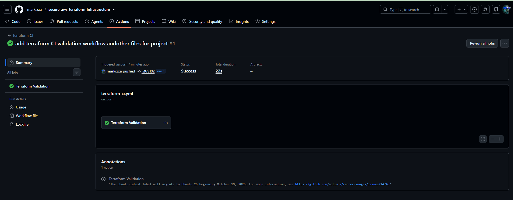

The successful run confirms that the repository could be checked out onto a clean GitHub-hosted runner, the required Terraform provider dependencies could be initialized, and the Terraform configuration passed both formatting and syntax/configuration validation.

### 10c — Terraform Validation Steps

The completed job showed each Terraform validation step succeeding independently.

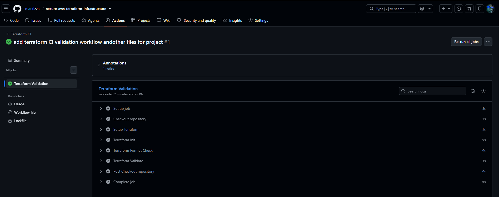

The key automated checks were:

```text
terraform fmt -check -recursive
```

This verifies that the Terraform configuration conforms to Terraform's canonical formatting.

and:

```text
terraform validate
```

This verifies that the Terraform configuration is syntactically valid and internally consistent.

The initialization step used:

```text
terraform init -backend=false
```

This allowed the CI runner to install the required provider dependencies without attempting to use or modify the local Terraform state backend.

### 10d — Result

**Result:** `Passed`

GitHub Actions successfully validated the Terraform configuration on a clean CI runner.

This demonstrated that:

- Terraform validation is no longer dependent only on the local development machine
- formatting is checked automatically
- Terraform configuration validity is checked automatically
- the workflow can run without AWS credentials
- the CI job has read-only repository permissions
- infrastructure-changing commands are not executed by the validation workflow
- future Terraform changes can be automatically checked when pushed to the repository

The next CI stage is to add an Infrastructure as Code security scanner and evaluate its findings.

### 11 Prediction — First Checkov Scan

This is my first use of Checkov against the Terraform configuration.

Based on the current design, I expect Checkov to identify several findings because the lab intentionally prioritises learning and controlled testing over production-grade hardening.

I expect approximately **4–7 failed checks**.

The resources I expect may be flagged are:

- `aws_instance.public`
  - because it intentionally receives a public IPv4 address
  - because detailed CloudWatch monitoring is not enabled
  - possibly because the instance does not use an IAM instance profile

- `aws_subnet.public`
  - because `map_public_ip_on_launch = true`

- `aws_vpc.main`
  - because VPC Flow Logs are not enabled

- the EC2 Security Group / egress rules
  - because HTTP and HTTPS egress are allowed to `0.0.0.0/0`

I expect some controls to pass, including:

- encrypted EC2 root storage
- IMDSv2 enforcement
- SSH restricted to a trusted `/32`
- no unrestricted inbound SSH from `0.0.0.0/0`

The purpose of the first scan is not to achieve zero findings. Each failed check will be reviewed and classified as:

1. fixed
2. accepted risk with technical reasoning
3. not applicable to the scope of this lab

I will compare the actual findings against this prediction and document any unexpected results.
